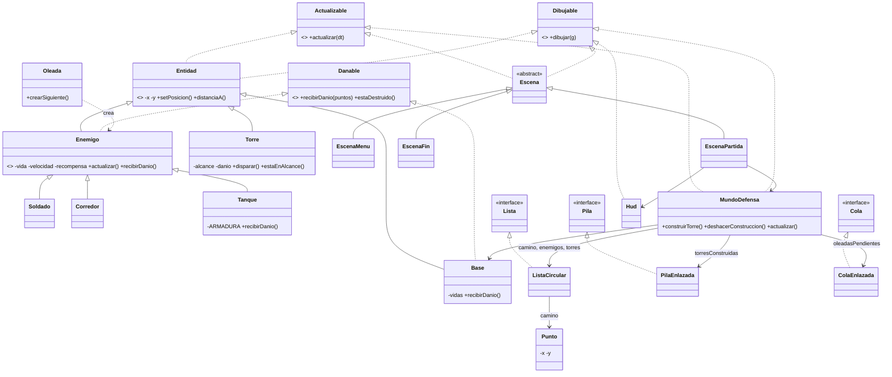

# Diseño y diagrama de clases

## Idea del juego
Defensa en el circuito: los enemigos salen de la base y recorren un camino **cerrado**. Si un enemigo completa una vuelta, le quita una vida a la base. El jugador construye torres con dinero (click) y puede deshacer la última construcción (Z). Los enemigos llegan en 5 oleadas que esperan en una cola.

## Las tres estructuras y su función real

| Estructura | Clase propia | Función en el juego |
|---|---|---|
| Lista (circular) | `ListaCircular` | El **camino cerrado**: el vértice posterior al último es el primero. También guarda los enemigos y torres en juego |
| Cola | `ColaEnlazada` | **Oleadas pendientes**: salen en el orden en que se programaron |
| Pila | `PilaEnlazada` | **Torres construidas**: Z deshace siempre la última y devuelve la mitad del costo |

## Paquetes y dependencias

```
juego            -> juego.pantallas, motor
juego.pantallas  -> juego.reglas, motor, ui, contratos
juego.reglas     -> juego.entidades, estructuras, motor, contratos
juego.entidades  -> estructuras, contratos
estructuras      -> (nada)
```
Las flechas van en un solo sentido: no hay dependencias circulares.

## Diagrama de clases



(Si el profesor pide el diagrama a mano o en foto, este sirve de guía para dibujarlo.)

## Cambios hechos a la carpeta del kit
El zip del repositorio traía archivos que **no compilan** y que el enunciado dice que el kit no incluye (entidades, física, mundo y estructuras ya hechas). Se eliminaron para poder compilar de cero:

- `src/provisorio/`, `src/fisica/`, `src/entidades/`
- `src/motor/Mundo.java`
- `src/estructuras/ListaBase.java`
- `src/demo/PelotaDemo.java`

No se modificó ningún otro archivo del kit. Solo se editó `verificador/PruebaMisEstructuras.java`, que el enunciado permite completar.
